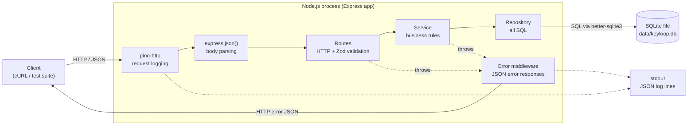
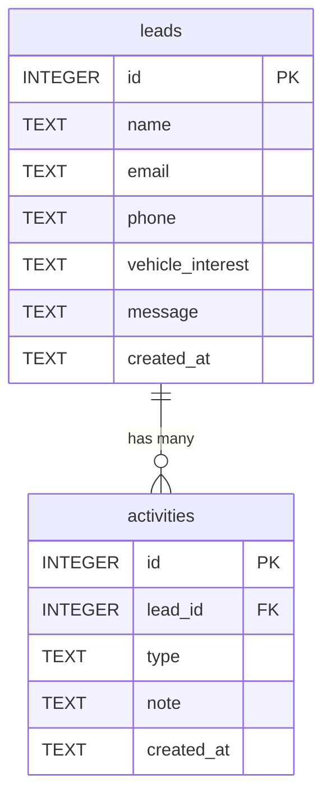
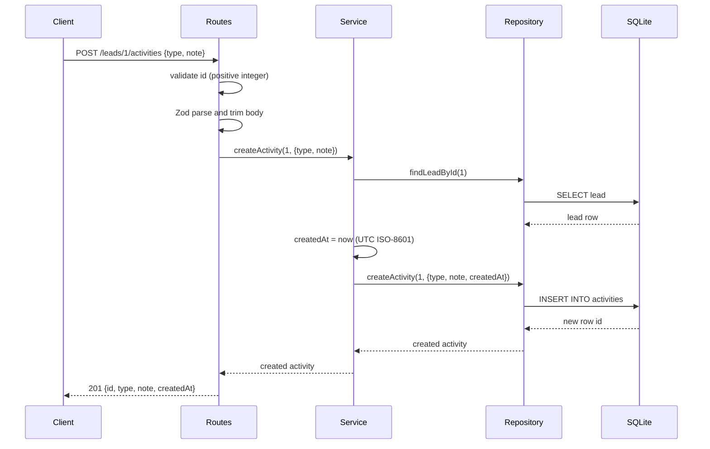

# System Design: Sales Lead Backend (Scenario C)

This document describes the backend for Scenario C of the Keyloop assessment. **Implemented** means it exists in this repository and was verified. **Production** means a recommendation that is not built.

## 1. Problem statement and scope

Salespeople receive leads from the dealership website. They need to see them, open one, review the follow-up already done, and log new follow-up. The assessment asks for three behaviours:

1. List incoming leads.
2. Show one lead with its follow-up activities in chronological order.
3. Persist a new follow-up activity for a lead.

**Implemented:** a REST API with four endpoints, a persistent SQLite database, request validation, structured logging, a seed script and automated tests.

**Not in scope:** a frontend (the client is cURL and the test suite), authentication, lead creation or editing, pagination, multiple dealerships, deployment, and metrics or tracing infrastructure. Sections 8 to 12 say how these would be added.

## 2. Assumptions

- Leads are created by another system (the website). This service reads them, so demo leads come from a seed script and there is no create-lead endpoint.
- An activity has a `type` (`call`, `email`, `meeting` or `note`) and a free-text `note`. There is no author field because there are no users.
- Activities are append-only. Timestamps are generated by the server, so a client cannot backdate or forge them.
- Chronological order is `created_at` ascending with `id` as tie-break. Leads are listed newest first.
- One dealership, one server process, one SQLite file, integer ids.

## 3. Architecture



The code follows `routes → service → repository → SQLite`; each layer only talks to the one below it.

## 4. Components

| Component | Role | Where |
|---|---|---|
| **Client** | Anything that speaks HTTP and JSON: cURL and the Supertest suite today, a web UI in future. | n/a |
| **Express app** | Builds the pipeline: request logging, JSON parsing, `/health`, the lead routes, then the error handler. `createApp(db)` takes the database as a required argument, so tests supply an in-memory one and cannot accidentally use the real file. | `src/app.ts` |
| **Server entry point** | Reads `PORT`, opens the file database, starts listening, and on SIGINT or SIGTERM stops the server and then closes the database. | `src/server.ts` |
| **Routes and Zod** | Translate HTTP into service calls. Validate `:id` (a positive integer) and, for POST, the body: `type` from four values, `note` a string that is non-empty after trimming. | `src/leads/routes.ts`, `schemas.ts` |
| **Service** | Business rules: a lead must exist before an activity is added; the activity timestamp is generated here; one lead is returned together with its activities. | `src/leads/service.ts` |
| **Repository** | The only place with SQL. SQL column aliases convert `snake_case` columns to the `camelCase` names in the JSON. | `src/leads/repository.ts` |
| **SQLite** | Persistent storage in a local file via `better-sqlite3`. Foreign keys are enabled on every connection and the schema is applied idempotently at startup. | `src/db.ts` |
| **Error middleware** | Converts errors into one shape, `{"error":{"code","message"}}`. Known application errors keep their status; Zod failures and malformed JSON become `400 INVALID_ACTIVITY`; anything else is logged and returned as a generic `500`. No stack traces or Zod internals reach the client. | `src/errors.ts` |
| **Seed script** | Inserts three demo leads and four activities in one transaction, only when the database has no leads. Fixed timestamps make it deterministic and safe to re-run. | `src/seed.ts` |

## 5. Data model



```sql
CREATE TABLE IF NOT EXISTS leads (
  id INTEGER PRIMARY KEY AUTOINCREMENT,
  name TEXT NOT NULL,
  email TEXT NOT NULL,
  phone TEXT,
  vehicle_interest TEXT,
  message TEXT,
  created_at TEXT NOT NULL
);

CREATE TABLE IF NOT EXISTS activities (
  id INTEGER PRIMARY KEY AUTOINCREMENT,
  lead_id INTEGER NOT NULL REFERENCES leads(id),
  type TEXT NOT NULL,
  note TEXT NOT NULL,
  created_at TEXT NOT NULL
);

CREATE INDEX IF NOT EXISTS idx_activities_lead
ON activities(lead_id, created_at, id);
```

One lead has zero or more activities; each activity belongs to exactly one lead through `lead_id`. With foreign keys enabled, the database refuses an activity for a lead that does not exist. The index on `(lead_id, created_at, id)` matches the "one lead's activities, oldest first" query.

Timestamps are fixed-width ISO-8601 UTC strings (`2025-03-10T16:30:00.000Z`), which sort alphabetically in time order, so `ORDER BY created_at` is correct as long as every writer uses that format. The server and seed script do.

## 6. Data flows

**List leads (`GET /leads`).** The route calls the service, which calls the repository. The repository runs `SELECT ... ORDER BY created_at DESC, id DESC` and returns camelCase objects. The route sends `200` with the array, without activities.

**Retrieve one lead (`GET /leads/:id`).** The route validates the id (invalid: `400 INVALID_LEAD_ID`). The service finds the lead (missing: `404 LEAD_NOT_FOUND`), then the repository reads its activities with `ORDER BY created_at ASC, id ASC`. The route sends `200` with the lead and an `activities` array, empty if there are none.

**Create an activity (`POST /leads/:id/activities`).**



Failures: an invalid id gives `400 INVALID_LEAD_ID`; a body that fails Zod or is not valid JSON gives `400 INVALID_ACTIVITY`; an unknown lead gives `404 LEAD_NOT_FOUND`. In every failure nothing is inserted. The lead-exists check and the insert are separate statements; in a single synchronous process nothing can run between them, and the foreign key is a backstop.

Every request also passes through pino-http, which logs it on completion.

## 7. Technology choices

| Choice | Justification | Alternative considered |
|---|---|---|
| **TypeScript on Node.js 24** | Types catch mistakes between layers. Node 24 is a supported LTS that the test tooling officially supports; `.nvmrc` pins it. | Plain JavaScript: less safe for little saving. |
| **Express 5** | Minimal and widely understood; thrown errors reach the error middleware without extra wiring. | Fastify (faster, more opinionated); NestJS (heavy for four endpoints). |
| **SQLite via better-sqlite3** | Real persistence in one file with no server to install, so a reviewer can clone and run. The synchronous API keeps repositories simple. | PostgreSQL: the right production choice, but more setup than this scope needs. |
| **Raw SQL in a repository** | Four short queries are easy to review, and SQL stays in one layer. | An ORM such as Prisma: more tooling than this size justifies. |
| **Zod** | States the activity rules once and gives a typed result. | Hand-written checks: more code, more drift. |
| **pino and pino-http** | Fast structured JSON logs with per-request logging built in. | `console.log`: unstructured. |
| **Vitest and Supertest** | Fast TypeScript tests that call the Express app directly without opening a port. | Jest: heavier TypeScript setup. |
| **tsx** | Runs TypeScript directly for the dev server and seed script. | Compiling before every run. |

## 8. Observability

**Implemented**

- **Structured request logging.** pino-http writes one JSON line per request on completion (method, URL, status, response time, headers). Responses with a 5xx status are logged at error level and everything else at info. It is registered first, so requests with unreadable bodies are still logged. `LOG_LEVEL` sets the level.
- **Error logging.** Unexpected errors are logged with the error attached; the client receives only a generic `500` body. Expected 400 and 404 responses appear in the request log with their status.
- **`GET /health`.** Returns `{"status":"ok"}` while the process is serving requests. It does not query the database.
- **Graceful shutdown.** On SIGINT or SIGTERM the server stops accepting connections, then closes the database and logs that it has stopped. Verified by hand.

**Production**

| Area | Improvement |
|---|---|
| Request IDs | Generate or accept an `X-Request-ID`, put it on every log line and return it in the response, so one request can be followed across logs and services. |
| Health checks | Separate liveness from readiness. Readiness should run a trivial query (for example `SELECT 1`) so an instance with a broken database leaves rotation. |
| Metrics | Prometheus-style request rate, per-route latency histograms, error rate by status and database query timing. |
| Tracing | OpenTelemetry spans across HTTP, service and database calls. |
| Central logs and alerts | Ship the JSON logs to a log platform. Alert on a rise in 5xx rate, p95 latency, failing readiness and repeated unhandled errors. |
| Log hygiene | Redact sensitive headers such as `authorization` and `cookie`, and avoid logging personal data from lead bodies. |

## 9. Scalability, performance, reliability and maintainability

**Scalability.** One process and one SQLite file. SQLite allows a single writer and `better-sqlite3` is synchronous, so each query briefly blocks the event loop. That suits this workload, not high concurrent write volume. The repository is the only code that knows SQL and `createApp(db)` receives its database from outside, so moving to PostgreSQL means reimplementing the repository (asynchronously), not the routes or services. Running several instances requires a shared database, which a local SQLite file is not.

**Performance.** The per-lead activity query is served by the `(lead_id, created_at, id)` index, and SQL statements are prepared once. `GET /leads` returns every lead; keyset pagination on `(created_at, id)` with a supporting index is the first change to make as the table grows. No performance measurements were taken.

**Reliability.** Foreign keys stop orphaned activities. Schema creation uses `IF NOT EXISTS` and the seed checks for existing data, so starting and seeding repeatedly is safe; the seed runs in a transaction, so it inserts everything or nothing. Shutdown closes the database after the server stops accepting requests. Production would add backups, a replicated database and a transaction around "check lead exists, then insert" for multi-process safety.

**Maintainability.** Small files with one job each and a single direction of dependency. Tests run the real Express app against a real in-memory SQLite database instead of mocks. Scope is deliberately small and written down in `PLAN.md` and `CLAUDE.md`. Testing is API-level only, and the restart-persistence check was done by hand rather than automated.

## 10. Security and validation

**Implemented**

- Route ids must be positive integers without leading zeros.
- The activity body is validated by Zod. Unknown fields, including a client-supplied `createdAt`, are dropped.
- All SQL uses prepared statements with bound parameters; user input is never concatenated into SQL.
- Error responses carry a code and message only: no stack traces or validation internals.
- JSON bodies are limited by Express's default size cap, and `data/*.db` and `.env` files are git-ignored.

**Production**

- **Authentication and authorization.** Today anyone who can reach the server can read lead names, emails and phone numbers and add activities. A real system needs authenticated users, roles and per-dealership access control. This is the most important gap.
- TLS at a gateway or proxy, rate limiting, a CORS policy, and handling of retention and deletion of personal data.
- A note-length limit, if the business wants one. None was specified.
- Smaller hardening items, none of which change the design:
  - consistent JSON handling for all HTTP errors, including unknown routes;
  - a `413 Payload Too Large` response for oversized bodies;
  - disabling unnecessary framework-identification headers such as `X-Powered-By`;
  - defense-in-depth database constraints, such as a `CHECK` on activity `type`, so the database enforces what the API already validates.

## 11. Tradeoffs

| Decision | Benefit | Cost |
|---|---|---|
| SQLite file | Zero setup, real persistence, easy to review | Single writer and single host |
| Raw SQL, schema applied at startup | Transparent and small | Manual mapping and no migration system |
| Seed instead of a create-lead endpoint | Keeps scope to the three required behaviours | The API cannot ingest real leads |
| Server-generated timestamps only | Cannot be forged or backdated | Cannot import historical activities |
| API-level tests only | Real behaviour end to end with little code | A failure points at the whole stack, not one layer |
| No pagination | Simple | Unbounded list response |

## 12. Future improvements

In rough priority order: authentication and per-dealership authorization; pagination on `GET /leads`; request IDs and a database-backed readiness check; the hardening items in section 10; a lead ingestion path (webhook or queue) with `POST /leads`; lead status and assignment; PostgreSQL with a migration tool; metrics and tracing; Docker and CI; an OpenAPI description; and an automated restart-persistence test.

## 13. GenAI in the Design Phase

The design was produced with **Claude Code** (Anthropic's AI coding agent) in its read-only planning mode, with me directing and reviewing.

**What the AI did.**

- Given the brief and my preferred stack (TypeScript, Node, Express, SQLite, Vitest, Supertest), it was asked to identify ambiguities and recommend assumptions, propose the smallest maintainable architecture, define the database model and endpoints, map requirements to tests, propose a folder structure, split the work into small steps and list what was unnecessary.
- It kept my stack and suggested three additions: `better-sqlite3` as the SQLite driver, Zod for validation and pino for logging.
- Its first plan had ten assumptions, a two-table schema, endpoints, a test map, a folder layout and ten implementation steps.
- After the design was settled and implemented, it drafted this document and the README from the actual code, and I reviewed them.

**Where I overruled it.** The first plan was sound but too large for a take-home. It included a create-lead endpoint, pagination, status values and filtering, a `performedBy` field on activities, backdated activities with future-date validation, an OpenAPI spec, WAL mode, request IDs, logging tests and overlapping unit and integration suites. I asked for those to be removed, for one focused test file, and for the work to be reduced to five checkpoints. That reduction is [PLAN.md](../PLAN.md). The removed ideas appear above as production improvements, not as current features.

**How the design was controlled.** The scope and rules were written into [CLAUDE.md](../CLAUDE.md) and [PLAN.md](../PLAN.md) before any code, so the agent had written constraints. Design choices were checked against the implementation as it was built; for example, the planned seven tests became 11 test cases. This document describes only what exists in the code, and keeps implemented and production items separate.

**Limits.** The AI proposed and drafted; I decided the scope, reviewed the output, and own the design. The design has not been load-tested or security-reviewed, and the production sections are recommendations, not verified claims.
